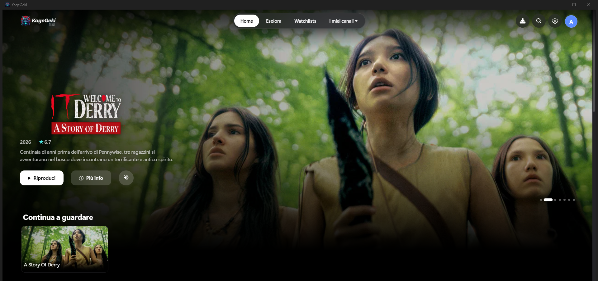

# KageGeki

KageGeki è un'app per sfogliare e guardare film e serie TV su PC Windows, telefoni e tablet Android, Android TV e TV LG.
Questo repository contiene solo i file da installare: si scaricano dalla pagina [Releases](https://github.com/adrianixio/kagerelease/releases).



## Installazione

KageGeki esiste in tre versioni, con file diversi. I file si scaricano dalla pagina **Releases** del repository
(<https://github.com/adrianixio/kagerelease/releases>): il repository è pubblico, per scaricare non serve un account GitHub.

| Dove | File da scaricare | Requisiti |
|---|---|---|
| **PC Windows** | `KageGeki-Setup-<versione>.exe` | Windows 10 o 11, 64 bit |
| **Telefono o tablet Android** | `KageGeki-android-<versione>-debug.apk` | Android 7.0 o successivo |
| **Android TV / Google TV / box Android** | lo stesso APK del telefono | Android 7.0 o successivo, telecomando |
| **Amazon Fire TV Stick** | lo stesso APK del telefono | Fire OS 6 o successivo (Android 7.1), telecomando; vedi la sezione dedicata |
| **TV LG (webOS)** | `KageGeki-webos-<versione>.ipk` | TV LG del 2022 o successiva (webOS 22+), modalità sviluppatore LG e un PC; **non ancora provata su una TV LG reale**, vedi la sezione dedicata |

I numeri di versione di Windows, Android e webOS sono indipendenti: ogni release contiene l'ultimo file di ciascuno
(il pacchetto per TV LG c'è solo se è stato compilato per quella release).

> I file **non sono firmati** da uno sviluppatore riconosciuto: Windows e Android mostrano un avviso la prima volta.
> È normale per un'app che non passa dagli store; gli avvisi si superano come descritto sotto.

---

## Fallo installare al tuo agent

Se usi un assistente che lavora sul tuo PC (Claude Code, Codex o simili), puoi fargli fare tutto: scaricare la release, installarla su Windows e mandare l'APK
alla TV o al telefono. Gli servono, già pronti sul PC: l'**accesso a GitHub con `gh`** (`gh auth status` deve dire che sei collegato)
e, per la TV o il telefono, **`adb`** nel `PATH`.

Per la TV (o il telefono) servono anche: **debug di rete/USB attivo** (vedi «C. Con il PC e adb» più sotto) e l'**indirizzo IP** del dispositivo.
Per il telefono con cavo USB basta il debug USB, senza IP.

Copia e incolla questo testo al tuo agent (cambia solo le parti tra `<...>`):

```text
Installa KageGeki dall'ultima release del repository GitHub adrianixio/kagerelease.

1. Controlla che `gh auth status` mostri un accesso valido; se no, fermati e dimmelo.
2. Scarica gli ultimi file della release in una cartella nuova e vuota (non nella cartella del progetto):
   gh release download --repo adrianixio/kagerelease --pattern "KageGeki-Setup-*.exe" --pattern "KageGeki-android-*.apk" --dir <cartella-nuova>
3. PC Windows: dimmi cosa stai per installare (nome e dimensione del file) e aspetta il mio sì; poi avvia l'installer
   con `/S` (installazione silenziosa, solo per il mio utente). Non cambiare impostazioni di sicurezza di Windows
   (SmartScreen, antivirus): se Windows blocca il file dimmelo e lo sblocco io.
4. TV o telefono Android: collegati con `adb connect <indirizzo-ip-della-tv>:5555` (o usa il telefono già collegato via USB),
   controlla con `adb devices` che compaia come "device" (non "unauthorized"), poi installa l'APK con
   `adb -s <dispositivo> install -r <cartella-nuova>/KageGeki-android-<versione>-debug.apk`.
   Se risponde "INSTALL_FAILED_UPDATE_INCOMPATIBLE" dimmelo: va disinstallata prima la versione presente e questo cancella i dati dell'app sul dispositivo.
5. Alla fine dimmi cosa è stato installato (versione e dispositivo) e cosa devo fare io: accesso con l'account e codice QR sulla TV.

Non installare nient'altro e non toccare altri dispositivi sulla rete.
```

Cosa fa l'agent, in pratica (puoi anche lanciare tu questi comandi):

```bash
gh release download --repo adrianixio/kagerelease --pattern "KageGeki-Setup-*.exe" --pattern "KageGeki-android-*.apk" --dir ./kagegeki-release
```

```bash
adb connect 192.168.1.50:5555
adb -s 192.168.1.50:5555 install -r ./kagegeki-release/KageGeki-android-4.0.0-debug.apk
```

```powershell
& ".\kagegeki-release\KageGeki-Setup-1.0.19.exe" /S
```

(i numeri di versione e l'indirizzo IP sono esempi: usa quelli veri della release e della tua TV).

---

## PC Windows

1. Scarica `KageGeki-Setup-<versione>.exe` dalla pagina Releases.
2. Fai doppio clic. Se compare «Windows ha protetto il PC» (SmartScreen): **Ulteriori informazioni** → **Esegui comunque**.
3. L'installazione è automatica, solo per il tuo utente, e crea il collegamento sul desktop e nel menu Start.
4. Avvia **KageGeki**. Al primo avvio crea l'account (e-mail e password) con «Crea account»: l'account è locale, resta sul PC.
5. Aggiungi i tuoi canali dalle impostazioni (la lista dei siti su cui cercare i video).

**Aggiornare:** scarica il nuovo `Setup` e avvialo, si installa sopra la versione presente. Account, liste e impostazioni restano.
**Disinstallare:** Impostazioni › App › KageGeki. I dati dell'utente non vengono cancellati.

---

## Telefono o tablet Android

1. Dal telefono apri la pagina Releases e scarica l'APK.
2. Aprilo dalle notifiche o dall'app **File** › Download.
3. Android chiede di consentire l'installazione di app da questa origine (**Impostazioni › Installa app sconosciute**, per il browser o per l'app File che hai usato): consenti, poi torna indietro e riprova.
4. Se compare l'avviso di Play Protect «App non verificata»: **Installa comunque**.
5. Apri **KageGeki**, accedi o registrati (la registrazione richiede il codice che ti ha dato chi gestisce l'account).

**Aggiornare:** installa il nuovo APK sopra il precedente. Se Android risponde «App non installata» è perché il vecchio APK era stato
compilato con un'altra chiave di firma: disinstalla l'app e installa quella nuova (le liste sono sull'account, non sul telefono).

### Trasmettere sul Chromecast

Dalla versione 4.2.0 il player del telefono può mandare il video su un Chromecast (o su una TV con Chromecast integrato).

1. Telefono e Chromecast devono essere collegati alla **stessa rete Wi-Fi**, e sul telefono devono esserci i **servizi Google Play** (senza, il tasto non compare).
2. Nel player, in alto a destra, accanto a **Fonti**, tocca il tasto **Trasmetti** e scegli il dispositivo.
3. Si trasmettono solo le fonti che non richiedono intestazioni speciali: con alcuni titoli può non essercene nessuna, e compare «Nessuna fonte si può trasmettere su Chromecast» (oppure «Per ora nessuna fonte si può trasmettere su Chromecast» se la ricerca delle fonti è ancora in corso: puoi riprovare più tardi). Mentre trasmetti, nell'elenco **Fonti** quelle che non si possono trasmettere sono grigie, con la scritta «Non si trasmette».
4. I sottotitoli non vengono mandati al Chromecast.
5. Sulla TV con l'app il tasto non c'è: la TV è già il ricevitore.

Se il Chromecast non riesce a riprodurre una fonte, l'app prova da sola la successiva che si può trasmettere (possono passare fino a circa 25 secondi prima che lo faccia); finite quelle, la trasmissione si chiude e il video continua sul telefono. La funzione non è ancora stata provata su un Chromecast reale: se la trasmissione non parte, tocca di nuovo **Trasmetti** e scegli **Interrompi**: il video riprende sul telefono.

---

## Android TV, Google TV e box Android

Sulle TV non c'è un browser comodo e il repository è privato, quindi il file va **portato sulla TV**. Tre modi, dal più semplice.

### A. Dal telefono, senza cavi (consigliato)

1. Scarica l'APK sul telefono come sopra.
2. Installa sul telefono e sulla TV l'app **Send Files to TV** (gratuita, su Google Play) oppure usa Google Drive / un servizio che tu abbia su entrambi.
3. Invia l'APK alla TV; sulla TV aprilo con l'app **File** (o con «Send Files to TV»).
4. Se la TV lo chiede, consenti l'installazione da questa app (**Impostazioni › App › Sicurezza e restrizioni › Origini sconosciute**; il percorso cambia da marca a marca).
5. Cerca **KageGeki** tra le app: ha la sua icona e il suo banner nella schermata iniziale.

### B. Con una chiavetta USB

1. Copia l'APK in una chiavetta USB (formattata FAT32 o exFAT).
2. Inseriscila nella TV, apri un gestore di file (ad esempio **File Commander** o **X-plore**, installabili da Google Play) e tocca l'APK.
3. Consenti le origini sconosciute se richiesto e installa.

### C. Con il PC e `adb` (per chi ha già Android SDK)

1. Sulla TV: **Impostazioni › Info › Build** → tocca sette volte «Build» per abilitare le opzioni sviluppatore; poi **Opzioni sviluppatore › Debug USB / Debug di rete**: attivalo.
2. Scopri l'indirizzo IP della TV (Impostazioni › Rete), poi dal PC:

```bash
adb connect 192.168.1.50:5555
adb -s 192.168.1.50:5555 install -r KageGeki-android-<versione>-debug.apk
```

(sostituisci l'indirizzo con quello della tua TV). La prima volta la TV chiede di autorizzare il PC: conferma.

### Primo accesso sulla TV

La pagina di accesso mostra un **codice QR e un codice**: con il telefono apri il QR (o vai all'indirizzo indicato), accedi con il tuo account e conferma il codice. La TV si collega da sola.
Poi usa le frecce del telecomando per spostarti, **OK** per scegliere, **Indietro** per tornare; nel player **OK** mette in pausa, **sinistra/destra** saltano, **su/giù** mostrano i controlli.

---

## Amazon Fire TV Stick

È lo stesso APK dell'Android TV, ma Fire OS ha un altro menu e **non ha Google Play**. Questa sezione non è ancora stata provata su un Fire Stick reale: se un passaggio non corrisponde alla tua versione, segnalalo.

**Quali modelli.** Serve Fire OS 6 (Android 7.1) o successivo. In genere vanno il Fire TV Stick 4K (2018) e i modelli più recenti (Lite, 3ª generazione, 4K Max). Il Fire TV Stick di 1ª e 2ª generazione ha Fire OS 5 (Android 5.1) e **non è supportato**: controlla il modello in **Impostazioni › Il mio Fire TV › Informazioni**.

**1. Consenti le app sconosciute.** Sul Fire Stick: **Impostazioni › Il mio Fire TV › Opzioni sviluppatore**. Attiva **Installa app sconosciute** (a seconda della versione si consente per una singola app, ad esempio «Downloader» o «Send Files to TV») e, se userai `adb`, anche **Debug ADB**. Se «Opzioni sviluppatore» non compare, vai in **Informazioni** e premi sette volte **OK** su «Fire TV Stick» (o sul nome del dispositivo).

**2. Porta l'APK sul Fire Stick.** Il repository è privato, quindi **Downloader** (l'app più usata per installare APK sul Fire Stick) non può scaricare direttamente dalla pagina Releases. Tre strade:

- **Send Files to TV** (consigliata): installala sul Fire Stick dall'Amazon Appstore e sul telefono da Google Play, invia l'APK dal telefono al Fire Stick e aprilo; il Fire Stick ti chiede di installarlo.
- **`adb` dal PC:** nelle impostazioni di rete del Fire Stick leggi l'indirizzo IP (**Impostazioni › Il mio Fire TV › Informazioni › Rete**), poi dal PC:

```bash
adb connect 192.168.1.60:5555
adb -s 192.168.1.60:5555 install -r KageGeki-android-<versione>-debug.apk
```

(sostituisci l'indirizzo con quello del tuo Fire Stick). La prima volta il Fire Stick chiede di autorizzare il PC: conferma.
- **Downloader con un link diretto:** se metti l'APK in un servizio che dia un indirizzo di download diretto (ad esempio un file condiviso su Drive o Dropbox) puoi incollarlo in Downloader. Attenzione: chi ha l'indirizzo può scaricare il file; eliminalo dopo l'installazione.

**3. Avvia l'app.** KageGeki compare in **Le tue app e canali**, premendo **Vedi tutto**. Come sulle altre TV, il primo accesso avviene con codice QR e codice; poi usa le frecce, **OK** e **Indietro**.

**Differenze rispetto all'Android TV**
- **Fonti:** il tasto **Menu** del telecomando (le tre linee) apre l'elenco delle fonti nel player.
- **Trasmetti:** non compare e non serve. Il Fire Stick riproduce direttamente nell'app e non usa Google Cast.
- **Pagina bianca all'avvio:** potrebbe succedere su un Fire Stick con WebView troppo vecchia. In quel caso aggiorna Fire OS (**Impostazioni › Il mio Fire TV › Informazioni › Verifica aggiornamenti**) e riprova; se non basta, quel modello non è adatto.

---

## TV LG (webOS)

Le TV LG non installano gli APK: hanno un pacchetto loro, `KageGeki-webos-<versione>.ipk`, con le stesse funzioni dell'app Android (ricerca, scheda, **Riproduci** automatico, elenco **Fonti** nel player).
**Questa versione non è ancora stata provata su una TV LG reale.** Prima di installarla conviene fare la prova minima: il pacchetto `KageGeki-webos-prova.ipk` (pochi KB) è sulla stessa pagina **Releases** e le istruzioni sono in [PROVA-TV-LG.md](PROVA-TV-LG.md); dice in 15 minuti se la TV regge l'app. Se un passaggio non corrisponde alla tua TV, segnalalo.

**Sicurezza, in breve.** Finché la modalità sviluppatore è attiva la TV tiene aperta sulla rete di casa una porta di accesso remoto (SSH, porta `9922`) protetta dalla chiave presa con `ares-novacom --getkey`: se non ti serve più, spegnila dall'app **Developer Mode**. KageGeki per TV LG è un'app sviluppatore **non firmata** e non passa dalla revisione di LG: installa solo i file `.ipk` della pagina Releases di questo repository.

**Quali modelli.** Serve una TV LG **del 2022 o successiva** (webOS 22 o più recente). Le TV più vecchie hanno un browser troppo vecchio e **non sono supportate**. La versione di webOS la trovi nelle impostazioni alla voce **Informazioni sulla TV** (il percorso cambia un po' da modello a modello); l'anno si legge anche nel nome del modello: ad esempio `OLED55C2…` è del 2022.

L'installazione passa dalla **modalità sviluppatore LG**: è gratuita, non modifica la TV e non serve il root, ma richiede un PC sulla stessa rete della TV e va rinnovata di tanto in tanto (vedi sotto).

**1. Account sviluppatore LG (una volta sola).** Registrati gratis su <https://webostv.developer.lge.com> (*Sign up*) e conferma l'e-mail.

**2. Sulla TV: attiva la modalità sviluppatore.**
1. Installa l'app **Developer Mode** dal **LG Content Store** della TV (cerca «Developer Mode»).
2. Aprila e accedi con l'e-mail e la password dell'account sviluppatore.
3. Attiva **Dev Mode Status**: la TV si riavvia.
4. Riapri **Developer Mode** e attiva **Key Server**. In basso vedi una **password di 6 caratteri** (maiuscole e minuscole contano) e **Remain Session**, il tempo che resta alla modalità sviluppatore.

L'indirizzo IP della TV è in **Impostazioni › Tutte le impostazioni › Rete › Connessione Wi-Fi** (o cablata) › dettagli.

**3. Sul PC: gli strumenti LG.** Serve **Node.js** (versione LTS, <https://nodejs.org>). Poi, in PowerShell:

```powershell
npm install -g @webos-tools/cli
ares-setup-device
```

Nel menu di `ares-setup-device` scegli **add** e inserisci: nome `tv`, l'indirizzo IP della TV, porta `9922`, utente `prisoner`; salva. Poi collega il PC alla TV (ti chiede la password di 6 caratteri vista nell'app Developer Mode):

```powershell
ares-novacom --device tv --getkey
```

In alternativa agli strumenti da riga di comando c'è **Dev Manager Desktop** (<https://github.com/webosbrew/dev-manager-desktop>), un'app della comunità che fa le stesse cose con i pulsanti.

**4. Installa e avvia KageGeki.** Scarica `KageGeki-webos-<versione>.ipk` dalla pagina Releases, vai nella cartella del file in PowerShell e:

```powershell
ares-install --device tv KageGeki-webos-<versione>.ipk
ares-launch --device tv it.kagegeki.webos
```

KageGeki compare anche tra le app della TV (tasto **Home**, in fondo all'elenco). All'avvio vedi per un attimo «Avvio in corso…», poi si apre l'app. Il primo accesso è come sulle altre TV: **codice QR e codice** da confermare con il telefono.

**Aggiornare:** ripeti `ares-install` con il nuovo `.ipk`: si installa sopra il precedente. **Disinstallare:** `ares-install --device tv --remove it.kagegeki.webos`, oppure dalla schermata delle app (tieni premuto **OK** sull'icona › Elimina).

**Telecomando**
- Frecce per spostarti, **OK** per scegliere, **Indietro** per tornare (dalla pagina iniziale chiude l'app). Il **puntatore** del Magic Remote funziona su tutti i pulsanti.
- Nel player: **OK** mette in pausa o riprende, **sinistra/destra** saltano di 10 secondi, **su/giù** mostrano i controlli, **Indietro** nasconde i controlli e, se sono già nascosti, chiude il player. Funzionano anche i tasti play, pausa, stop, avanti e indietro.
- **Tasto giallo = Fonti:** apre l'elenco delle fonti nel player (il telecomando LG non ha il tasto Menu).

**Rinnovare la modalità sviluppatore (EXTEND).** La modalità sviluppatore dura un tempo limitato: **50 ore** nelle guide LG più vecchie, molto di più (fino a circa 1000 ore) in quelle recenti; dipende dalla versione della TV. Il tempo che resta è **Remain Session** nell'app **Developer Mode**: prima che finisca apri l'app e premi **EXTEND**. Ricordatelo: conviene controllare ogni tanto.

**Se scade:** la TV esce dalla modalità sviluppatore e **cancella le app installate così**, KageGeki compresa. I tuoi dati (liste, profili) sono sull'account e non si perdono: riattiva la modalità sviluppatore (punto 2), poi ripeti `ares-novacom --getkey` (punto 3) e `ares-install` (punto 4), e accedi di nuovo con il codice QR.

**Se qualcosa non va**
- **«Il servizio non parte»** o **«La porta 38457 è occupata da un'altra app»**: premi **Riprova**; se non basta chiudi KageGeki, spegni e riaccendi la TV dal telecomando e riaprila.
- **«Non riesco ad aprire la pagina locale»**: premi **Riprova**. Se succede sempre, la TV non permette all'app di aprire la sua pagina locale: è proprio il caso che la prova minima (`KageGeki-webos-prova.ipk`, istruzioni in `webos/smoke/ISTRUZIONI.md`) serve a scoprire; segnalalo con una foto dello schermo.
- **Una fonte non parte:** il player passa da solo alla successiva. Le fonti DASH (`.mpd`) e quelle con codec che la TV non legge non funzionano sulle TV LG; i canali ospitati nella rete di casa non sono raggiungibili da questa versione.

---

## Se qualcosa non va

- **«App non installata» su Android:** disinstalla la versione presente e riprova (vedi sopra).
- **Il pulsante «Riproduci» non c'è:** si mostra solo nelle app e solo se l'account ha almeno un canale: aggiungine uno nelle impostazioni dell'account.
- **«Non trovato» o «I canali non rispondono»:** controlla che l'indirizzo del canale sia ancora quello giusto (i siti cambiano dominio).
- **Windows non riesce ad avviare il file:** clic destro sul file › Proprietà › spunta «Sblocca» in fondo, poi riprova.
